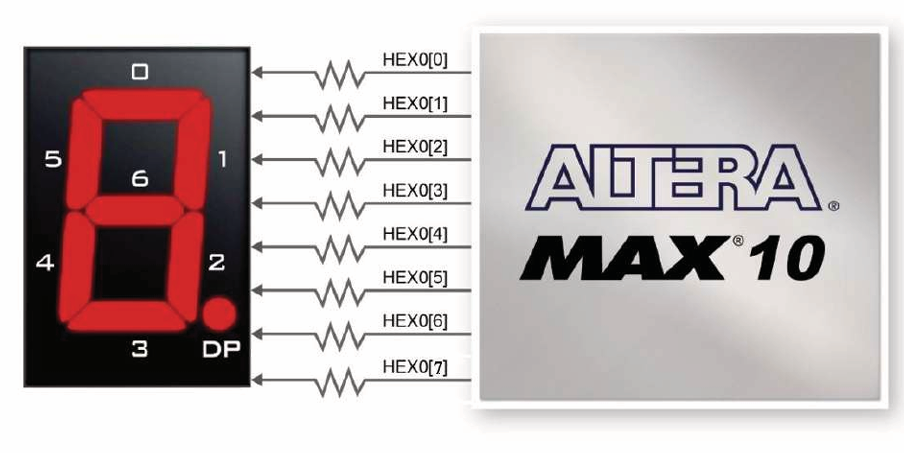
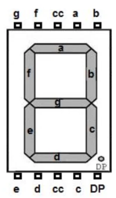
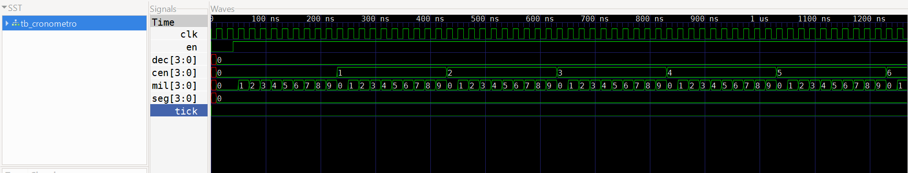
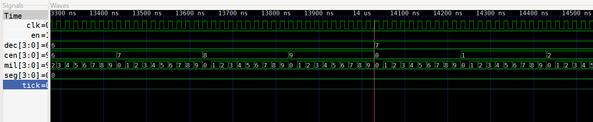

# Lab04 - Cronometro implementando el divisor de frecuencia.

## Integrantes

    * [Cristian Santiago Alfonso Valderrama]
    (https://github.com/CristianAlfonso-ecci) 
    * [Fredi Alexander Melo Prada]
    (https://github.com/Fredi-melo-ecci) 
    * [Fabiam Acevedo]
    (https://github.com/Fabiam-Acevedo-ECCI) 

## Informe

Indice:

1. [Cronometro](#1-Cronometro)
2. [Simulaciones](#2-simulaciones)
3. [Implementación en FPGA](#3-implementación-en-fpga)
4. [Resultados](#4-resultados)
5. [Conclusiones](#5-conclusiones)
6. [Referencias](#6-referencias)

## Documentación del diseño implementado

Todos los módulos fueron simulados para verificar su correcto comportamiento lógico y, posteriormente, se sintetizaron e implementaron en una FPGA usando Quartus, comprobando su operación en hardware.

## 1. Cronometro

### 1.1 Divisor de frecuencia (señal de reloj clk)

El divisor de frecuencia tiene como finalidad generar una señal periódica de habilitación, denominada `tick`, a partir del reloj principal de la FPGA (`clk`). Esta señal permite que los módulos posteriores, como el contador del cronómetro, se actualicen a una velocidad menor y controlada.

Para ello, el módulo utiliza un contador interno de 16 bits llamado `count`, el cual incrementa su valor en cada flanco ascendente de la señal `clk`. Cuando el contador alcanza el valor `49999`, equivalente a completar 50.000 ciclos de reloj desde `0` hasta `49999`, se reinicia en cero y la salida `tick` toma el valor lógico `1` durante un único ciclo de reloj.

En los ciclos restantes, mientras el contador continúa su conteo, la señal `tick` permanece en `0`. De esta forma, se obtiene un pulso periódico que puede emplearse como señal de habilitación para controlar la velocidad de conteo del cronómetro.

### 1.2 Módulo selector de velocidad

El módulo `seleccion` permite ajustar la velocidad de avance del cronómetro mediante dos interruptores físicos de la FPGA, representados por la entrada `sw[1:0]`. Su función es recibir los pulsos de referencia `tick`, generados por el divisor de frecuencia, y producir una señal de habilitación llamada `en`.

La salida `en` funciona como un pulso de control para el cronómetro. Cuando `en` toma el valor lógico `1`, el contador de tiempo puede incrementar su valor. De esta manera, el módulo modifica la velocidad efectiva del cronómetro sin alterar el reloj principal `clk` de la FPGA.

El módulo se compone de dos bloques `always`. El primer bloque, `always @(*)`, corresponde a lógica combinacional y determina el valor de `limit` según la posición de los interruptores:

| `sw[1:0]` | `limit` | Funcionamiento |
|---|---:|---|
| `00` | `999` | Genera un pulso `en` cada 1000 pulsos `tick`. |
| `01` | `99` | Genera un pulso `en` cada 100 pulsos `tick`. |
| `10` | `9` | Genera un pulso `en` cada 10 pulsos `tick`. |
| `11` | `0` | Genera un pulso `en` con cada pulso `tick`. |

El segundo bloque, `always @(posedge clk)`, corresponde a lógica secuencial y controla el contador interno `count`. En cada flanco ascendente del reloj, el módulo verifica si se recibió un pulso `tick`. Si el contador alcanza el valor definido en `limit`, se reinicia a cero y la salida `en` toma el valor `1` durante un único ciclo de reloj. En los demás casos, `en` permanece en `0`.

El módulo también incorpora un reinicio síncrono mediante la señal `rst`. Cuando esta señal se activa, el contador interno y la salida de habilitación se inicializan en cero en el siguiente flanco ascendente de `clk`.

### 1.3 Contador

El módulo `contador` implementa un contador decimal síncrono de tipo módulo 10. Su función es recorrer los valores entre 0 y 9 y almacenar el resultado en la salida de 4 bits `q[3:0]`. Este módulo representa la unidad básica de cada dígito decimal que se visualiza en el cronómetro.

El contador opera de forma sincronizada con el flanco ascendente de la señal `clk`. Cuando la señal de reinicio `rst` está activa, la salida `q` se inicializa en cero. Como el reinicio se evalúa dentro del bloque `always @(posedge clk)`, corresponde a un reset síncrono.

Si `rst` está desactivado y la señal de habilitación `en` toma el valor lógico `1`, el contador incrementa su valor. Para los valores entre 0 y 8, la salida aumenta en una unidad. Cuando el valor almacenado alcanza `9`, el siguiente pulso de habilitación reinicia el contador en `0`. Este comportamiento corresponde a un contador módulo 10 o contador BCD.

Cuando `en = 0`, el módulo no modifica la salida y conserva el último valor contado. Esta condición permite controlar el instante en que el contador avanza, utilizando los pulsos de habilitación generados por el módulo selector.

El cronómetro completo se construye mediante cuatro instancias de este contador: `counter0`, `counter1`, `counter2` y `counter3`. Estos bloques representan, respectivamente, las unidades, decenas, centenas y millares. Su funcionamiento es similar al cuentakilómetros de un automóvil: cuando las unidades pasan de 9 a 0, se incrementan las decenas; cuando las decenas pasan de 9 a 0, se incrementan las centenas, y así sucesivamente hasta el último dígito.

Por ejemplo, la secuencia de conteo puede observarse de la siguiente manera:

```text
0007 → 0008 → 0009 → 0010 → 0011
```

De este modo, la conexión de los cuatro contadores permite representar valores decimales desde `0000` hasta `9999`.

### 1.4 Módulo decodificador de 7 segmentos

El módulo `siete_seg` implementa un decodificador BCD a display de 7 segmentos. Su función es convertir el valor binario de 4 bits recibido en la entrada `A[3:0]` en un patrón de siete señales de salida, `seg[6:0]`, encargado de controlar los segmentos del display y representar un dígito decimal.

La salida del módulo se organiza como `seg[6:0] = {a, b, c, d, e, f, g}`, donde cada bit controla uno de los siete segmentos del display. Debido a que la FPGA utiliza displays de ánodo común, la lógica de activación es activa en bajo: un valor lógico `0` enciende un segmento y un valor `1` lo apaga.

La conversión se realiza mediante un bloque combinacional `always @(*)` y una estructura `case (A)`. Cada combinación binaria válida de la entrada, desde `0000` hasta `1001`salida espec los números 

Por ejemplo,módulo asign enciende losmostrar el n segmento cenuno de los dpatrón adecu correspondie

Los valores  `1010` y `11 BCD válidos. Por esta razón, se utiliza la condición `default`, que asigna `seg = 7'b1111111` y mantiene todos los segmentos apagados. Esta condición evita que el display muestre caracteres no deseados cuando recibe una combinación no válida.


### 1.5 Módulo principal del cronómetro

El módulo `cronometro` integra cuatro instancias del módulo `contador` para formar un sistema de conteo decimal de cuatro dígitos. Las salidas `mil`, `cen`, `dec` y `seg` representan, respectivamente, las unidades de milisegundo, centésimas, décimas y segundos. Cada señal tiene un ancho de 4 bits y almacena valores decimales entre 0 y 9.

La arquitectura se basa en una cascada de habilitación. El contador de menor peso, denominado `mili`, recibe directamente la señal `en`, proveniente del módulo selector. Los demás contadores solo se habilitan cuando reciben el pulso `en` y todos los dígitos de menor peso han alcanzado el valor decimal 9.

Las señales de habilitación se generan de la siguiente manera:

| Señal | Expresión lógica | Función |
|---|---|---|
| `en_mil` | `en` | Habilita directamente el conteo de las unidades de milisegundo. |
| `en_cen` | `en && (mil == 9)` | Incrementa las centésimas cuando las milésimas pasan de 9 a 0. |
| `en_dec` | `en && (mil == 9) && (cen == 9)` | Incrementa las décimas cuando milésimas y centésimas completan su ciclo. |
| `en_seg` | `en && (mil == 9) && (cen == 9) && (dec == 9)` | Incrementa los segundos cuando los tres dígitos inferiores completan su ciclo. |

Este mecanismo actúa como un acarreo decimal. Por ejemplo, cuando el cronómetro se encuentra en `0.999` y se recibe un nuevo pulso de habilitación, los dígitos `mil`, `cen` y `dec` vuelven a cero, mientras que el contador `seg` incrementa su valor. Como resultado, el cronómetro cambia de `0.999` a `1.000`.

Todos los contadores utilizan la misma señal de reloj `clk`, por lo que sus cambios se producen de forma síncrona. Además, la entrada `rst` se conecta a las cuatro instancias, permitiendo reiniciar todos los dígitos a cero de manera simultánea.

---
PINOUT DISPLAY 7 SEGMENTOS FPGA ALTERA 10 MAX





### Evidencias de simulación

Las tablas de verdad fueron verificadas mediante simulación ejecutando GTKWAVE (Verilog) de los respectivos módulos.

---
Codificación en código Verilog:

### Divisor de frecuencia (señal de reloj clk)

```verilog
module divisor (
    input clk,
    input rst,
    output reg tick
);

    reg [15:0] count;

    always @(posedge clk) begin

        if (rst) begin
            count <= 0;
            tick <= 0;
        end

        else if (count == 49999) begin
            count <= 0;
            tick <= 1;
        end

        else begin
            count <= count + 1;
            tick <= 0;
        end

    end

endmodule
```

### Módulo selector de velocidad
```verilog
`include "cronometro.v"
//`include "divisor.v"

module seleccion (
    input clk,
    input rst,
    input tick,
    input [1:0] sw,
    output reg en
);

    reg [9:0] count;
    reg [9:0] limit;

    always @(*) begin

        case (sw)

            2'b00: limit = 10'd999;
            2'b01: limit = 10'd99;
            2'b10: limit = 10'd9;
            2'b11: limit = 10'd0;

            default: limit = 10'd999;

        endcase

    end

    always @(posedge clk) begin

        if (rst) begin
            count <= 0;
            en <= 0;
        end

        else begin

            en <= 0;

            if (tick) begin

                if (count == limit) begin
                    count <= 0;
                    en <= 1;
                end

                else begin
                    count <= count + 1;
                end

            end

        end

    end

endmodule
```
### Módulo decodificador de 7 segmentos(anodo comun)

```verilog

module siete_seg (
    input [3:0] A,
    output reg [6:0] seg
);

    always @(*) begin

        case (A)

            4'b0000: seg = 7'b1000000;
            4'b0001: seg = 7'b1111001;
            4'b0010: seg = 7'b0100100;
            4'b0011: seg = 7'b0110000;
            4'b0100: seg = 7'b0011001;
            4'b0101: seg = 7'b0010010;
            4'b0110: seg = 7'b0000010;
            4'b0111: seg = 7'b1111000;
            4'b1000: seg = 7'b0000000;
            4'b1001: seg = 7'b0010000; // se deja haboilitado hasta el numero decimal 9 
            // 4'b1010: seg = 7'b0001000;
            // 4'b1011: seg = 7'b0000011;
            // 4'b1100: seg = 7'b1000110;
            // 4'b1101: seg = 7'b0100001;
            // 4'b1110: seg = 7'b0000110;
            // 4'b1111: seg = 7'b0001110;

            default: seg = 7'b1111111;

        endcase

    end

endmodule

```
### Módulo principal del cronómetro


``` verilog
`include "contador.v"
`include "divisor.v"
`include "7_seg.v"

module cronometro (
    input clk,
    input rst,
    input tick,
    input en,

    output [3:0] mil,
    output [3:0] cen,
    output [3:0] dec,
    output [3:0] seg
);

    wire en_mil;
    wire en_cen;
    wire en_dec;
    wire en_seg;

    assign en_mil = en;

    assign en_cen = en &&
                    (mil == 9);

    assign en_dec = en &&
                    (mil == 9) &&
                    (cen == 9);

    assign en_seg = en &&
                    (mil == 9) &&
                    (cen == 9) &&
                    (dec == 9);

    contador mili (
        .clk(clk),
        .rst(rst),
        .en(en_mil),
        .q(mil)
    );

    contador cent (
        .clk(clk),
        .rst(rst),
        .en(en_cen),
        .q(cen)
    );

    contador dece (
        .clk(clk),
        .rst(rst),
        .en(en_dec),
        .q(dec)
    );

    contador segu (
        .clk(clk),
        .rst(rst),
        .en(en_seg),
        .q(seg)
    );

endmodule

```

### Modulo Selector (se carga en quartus, encargado de seleccionar)

El módulo `select` se encarga de decidir qué valor se muestra en el display de 7 segmentos: el resultado de la suma o el valor de la entrada `A`, según la posición del interruptor `sel`.

- Si `sel = 0`, se muestra el resultado de la suma (`res`).
- Si `sel = 1`, se muestra directamente el valor de `A`.

El bloque `always @(*)` hace esta selección de forma automática: cada vez que cambia `sel`, `A` o el resultado de la suma, actualiza la salida `So` sin necesidad de un reloj. Finalmente, el módulo envía el valor seleccionado al decodificador de 7 segmentos para que se visualice en el display.

```verilog
`include "sumadorthree.v"
`include "seg.v"

module select (
    input wire [3:0] A,
    input wire [3:0] B,
    input wire Ci,
    input wire sel,
    output wire[6:0] seg,
    output reg [3:0] So
);

    wire [3:0] res;
    sum3b sum (
        .A(A[2:0]),
        .B(B),
        .Ci(Ci),
        .So(res),
        .Co()
    );
    always @(*) begin
        case (sel)
            1'b0: begin
                So = res;
            end
            1'b1: begin
                So = A;
            end
        endcase
    end

    seg segs (
        .A(So),
        .seg(seg)
    );   
endmodule
```

Codificación en código Verilog tb_selector:

```verilog
`timescale 1ns / 1ps
`include "sel.v"

module tb_sel;
    reg [3:0] A;
    reg [2:0] B;
    reg Ci;
    reg sel;

    wire [6:0] seg;
    wire [3:0] So;

    integer i, j;

    select uut (
        .A(A),
        .B(B),
        .Ci(Ci),
        .sel(sel),
        .seg(seg),
        .So(So)
    );

initial begin
    $dumpfile("tb_sel.vcd");
    $dumpvars(0,tb_sel);

    for(i=0; i<16; i=i+1) begin
        for(j=0; j<8; j=j+1) begin
            A=i;
            B=j;
            Ci=0;
            sel=0;
            #10;
        end
    end
    for(i=0; i<16; i=i+1) begin
            A=i;
            Ci=0;
            sel=1;
            #10;
    end
end
endmodule
```

---

## 2. Simulaciones

Antes de llevar a cabo la implementación física, el diseño se sometió a un proceso de simulación por GTKWAVE con el fin de verificar el comportamiento lógico del circuito.

---
- CRONOMETRO






## 3. Implementación en FPGA

Después de verificar el funcionamiento de los módulos mediante simulación, se implementó el diseño completo del cronómetro en la FPGA Altera MAX 10 utilizando el software Quartus. El sistema integró el divisor de frecuencia, el selector de velocidad, los contadores decimales conectados en cascada y los módulos decodificadores para display de 7 segmentos.

Para visualizar el conteo se utilizaron cuatro displays de 7 segmentos. Cada display representa uno de los dígitos del cronómetro: milisegundos, centésimas, décimas y segundos. Las salidas de 4 bits generadas por los contadores (`mil`, `cen`, `dec` y `seg`) se conectaron a cuatro instancias del módulo `siete_seg`,encargado de convertir cada valor BCD en las siete señales necesarias para controlar los segmentos del display.

La disposición lógica empleada fue la siguiente:

```text
HEX3   HEX2   HEX1   HEX0
 seg    dec    cen    mil
```

De esta forma, el dígito de menor peso (`mil`) se visualiza en `HEX0`, mientras que el contador de segundos (`seg`) se visualiza en `HEX3`. Por ejemplo, para el valor `1.234`, los displays presentan los valores `1`, `2`, `3` y `4`.

La asignación de las señales a los pines físicos de la tarjeta se realizó mediante la herramienta Pin Planner de Quartus. Se configuraron las entradas correspondientes al reloj, al reinicio y a los interruptores de control, así como las salidas de cada uno de los cuatro displays: `HEX0[6:0]`, `HEX1[6:0]`, `HEX2[6:0]` y `HEX3[6:0]`.

Debido a que la tarjeta utiliza displays de ánodo común, la lógica de control es activa en bajo. Por esta razón, el decodificador asigna un valor lógico `0` a los segmentos que deben encenderse y un valor `1` a los segmentos que deben permanecer apagados.

Finalmente, el diseño fue compilado y programado en la FPGA. La implementación física permitió comprobar el avance del cronómetro y verificar que los cuatro displays actualizaran los valores de manera sincronizada de acuerdo con la velocidad seleccionada mediante los switche

### Evidencias de implementación

En esta sección se incorporan las evidencias obtenidas durante la implementación y demostración del funcionamiento de los circuitos en FPGA.

[Ver implementación de DIVISOR DE FRECUENCIA EN UN CRONOMETRO descrito en FPGA con salida en display de 7 segmentos](https://youtu.be/m1DGkvdYnMI)

---

## 4. Resultados

La simulación permitió comprobar el funcionamiento integrado del cronómetro antes de su implementación física. Mediante el testbench se verificó la generación de los pulsos de habilitación, el comportamiento de los contadores decimales y la propagación del acarreo entre los cuatro dígitos. Se observó que cada contador avanzaba únicamente cuando recibía su respectiva señal de habilitación y que, al alcanzar el valor `9`, retornaba a `0`, permitiendo el incremento del dígito inmediatamente superior.

Asimismo, se validó el funcionamiento del divisor de frecuencia y del módulo selector de velocidad. Dependiendo de la combinación aplicada a los interruptores `sw[1:0]`, el sistema modificó la cantidad de pulsos `tick` necesarios para generar la señal `en`. Esto permitió obtener diferentes velocidades de conteo sin alterar la señal de reloj principal de la FPGA.

Durante la simulación, las salidas `mil`, `cen`, `dec` y `seg` mostraron una secuencia de conteo decimal coherente. Por ejemplo, al completarse el ciclo de los dígitos inferiores, se observó la transición de `0.999` a `1.000`, confirmando el funcionamiento correcto de la lógica de acarreo en cascada.

La implementación en la FPGA Altera MAX 10 confirmó los resultados obtenidos en el entorno de simulación. Los cuatro displays de 7 segmentos visualizaron de forma sincronizada los valores generados por los contadores, representando las unidades de milisegundo, centésimas, décimas y segundos. Al modificar los interruptores de selección, fue posible observar directamente el cambio en la velocidad de avance del cronómetro.

Finalmente, se comprobó que el decodificador BCD a 7 segmentos operó correctamente con los displays de ánodo común de la tarjeta. Los dígitos entre `0` y `9` se visualizaron de acuerdo con las señales generadas por el módulo `siete_seg`, utilizando lógica activa en bajo, donde un `0` lógico enciende el segmento correspondiente. De esta forma, la implementación física validó la correspondencia entre la simulación en Verilog y el comportamiento real del sistema en hardware.


## 5. Conclusiones

- Se diseñó e implementó un cronómetro digital en Verilog para una FPGA Altera MAX 10, integrando un divisor de frecuencia, un selector de velocidad, contadores BCD en cascada y decodificadores para displays de 7 segmentos.

- La estructura modular del diseño facilitó la construcción, simulación y verificación de cada bloque funcional, permitiendo integrar el sistema completo de manera organizada y reutilizable.

- El divisor de frecuencia y el selector controlaron la velocidad de avance del cronómetro mediante pulsos de habilitación (`en`), evitando modificar directamente el reloj principal de la FPGA y manteniendo un funcionamiento síncrono.

- La conexión en cascada de cuatro contadores módulo 10 permitió representar milisegundos, centésimas, décimas y segundos. La lógica de acarreo aseguró transiciones correctas entre los dígitos, por ejemplo, de `0.999` a `1.000`.

- La simulación y la implementación física validaron el comportamiento del sistema. Los cuatro displays de 7 segmentos visualizaron correctamente el conteo mediante lógica activa en bajo, propia de los displays de ánodo común de la FPGA.
---

## 6. Referencias

* Material de clase de la asignatura Técnicas Digitales, Universidad ECCI.
* Documentación y material proporcionado para el Laboratorio 04: divisor de frecuencia.
* IEEE Standard for Verilog Hardware Description Language.
* Manual de usuario DE10-Lite Cost-effective Max 10 board
