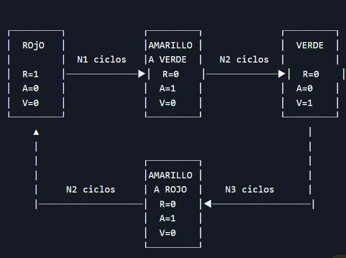
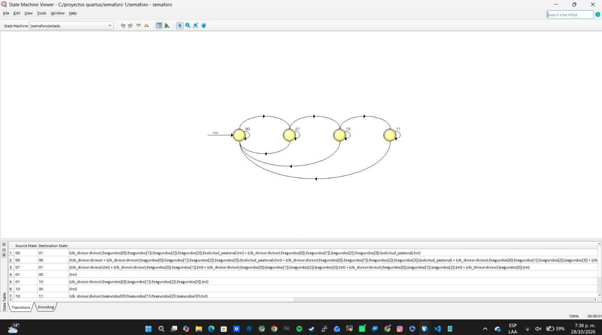
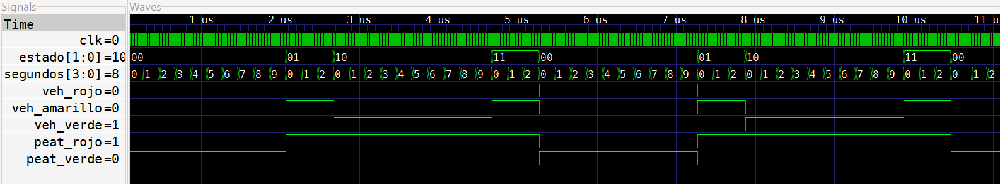

# Lab05 - Máquinas de Estado Finito: Semáforo Básico en FPGA.

## Integrantes

    * [Cristian Santiago Alfonso Valderrama]
    (https://github.com/CristianAlfonso-ecci) 
    * [Fredi Alexander Melo Prada]
    (https://github.com/Fredi-melo-ecci) 
    * [Fabiam Acevedo]
    (https://github.com/Fabiam-Acevedo-ECCI) 

## Informe

Indice:

1. [Semaforo](#1-Semaforo)
2. [Simulaciones](#2-simulaciones)
3. [Implementación en FPGA](#3-implementación-en-fpga)
4. [Preguntas de análisis](#4-Preguntas-de-análisis)
5. [Conclusiones](#5-conclusiones)
6. [Referencias](#6-referencias)

## Documentación del diseño implementado

Todos los módulos fueron simulados para verificar su correcto comportamiento lógico y, posteriormente, se sintetizaron e implementaron en una FPGA usando Quartus, comprobando su operación en hardware.

## 1. Semaforo

### 1.1 Introducción

El presente informe describe el diseño, la implementación y las pruebas físicas de un sistema de semaforización vehicular y peatonal mediante una tarjeta FPGA DE10-Lite de la familia MAX 10. El desarrollo se realizó en Verilog, utilizando una máquina de estados finitos tipo Moore para organizar la secuencia de funcionamiento y definir las salidas correspondientes a cada etapa del semáforo.

El sistema integra un módulo de control, un divisor de frecuencia y contadores que permiten establecer los intervalos de las luces roja, amarilla y verde. A partir del reloj de 50 MHz de la tarjeta, se genera una referencia temporal de un segundo para controlar la duración de los estados. Asimismo, se coordinan las señales del semáforo vehicular y del peatonal, de manera que el paso peatonal se habilite durante la etapa de rojo vehicular.

Como funcionalidad adicional, se incorporaron un botón de solicitud y un buzzer, con el propósito de proporcionar una indicación sonora durante el verde peatonal cuando exista una solicitud previa del usuario. El diseño se llevó a un montaje físico con la FPGA y dos módulos de semáforo, en el cual se realizaron pruebas del prototipo.

Este laboratorio permitió aplicar conceptos de lógica combinacional y secuencial, máquinas de estados, temporización y descripción de hardware. En el informe se presentan la arquitectura del sistema, los cálculos de temporización, la implementación en Verilog, las evidencias del montaje y el análisis de los resultados obtenidos.

### 1.2 Marco teórico

### - Sistemas secuenciales y máquinas de estados finitos

Un sistema digital secuencial conserva información sobre su funcionamiento anterior mediante registros. A diferencia de la lógica combinacional, cuya salida depende de las entradas actuales, un sistema secuencial utiliza también la información almacenada para determinar su comportamiento.

Una máquina de estados finitos, o FSM (Finite State Machine), permite representar este comportamiento mediante un conjunto limitado de estados y reglas de transición. Sus elementos principales son:

- Estados: representan las condiciones de funcionamiento del sistema.
- Entradas: corresponden a las señales que intervienen en las decisiones de control.
- Lógica de transición: determina el próximo estado.
- Salidas: son las señales de control generadas por la máquina.
- Estado inicial: establece la condición de arranque o reinicio.

En el semáforo, los estados representan las distintas etapas de circulación, mientras que el cumplimiento del tiempo asignado a cada etapa determina las transiciones.

### - Modelos Moore y Mealy

Las máquinas de estados se clasifican principalmente en los modelos Moore y Mealy. En una máquina Moore, las salidas dependen del estado actual. En una máquina Mealy, las salidas dependen tanto del estado actual como de las entradas.

El control principal del semáforo se desarrolla mediante el modelo **Moore**, ya que cada estado establece una combinación definida de luces vehiculares y peatonales. Así, las entradas y los contadores determinan cuándo debe producirse una transición, mientras que el estado determina cuáles luces se activan.

Esta organización facilita la representación del sistema mediante un diagrama de estados y permite separar las decisiones de transición de las señales que controlan los módulos luminosos.

### - Secuencia del semáforo vehicular y peatonal

El sistema coordina el paso vehicular y peatonal mediante una secuencia repetitiva. En el diseño desarrollado se distinguen cuatro estados:

| Estado | Luz vehicular activa | Luz peatonal activa | Duración programada |
|---|---|---|---|
| Rojo vehicular | Roja | Verde | 10 s |
| Amarillo hacia verde | Amarilla | Roja | 3 s |
| Verde vehicular | Verde | Roja | 10 s |
| Amarillo hacia rojo | Amarilla | Roja | 3 s |

Aunque las dos etapas amarillas activan la misma luz, se representan mediante estados diferentes porque conducen a estados distintos. Una precede al verde vehicular y la otra al rojo vehicular.

La coordinación establece que el verde peatonal se habilite durante el rojo vehicular. Durante las etapas amarillas y el verde vehicular, el semáforo peatonal permanece en rojo. Esta relación evita que el diseño autorice simultáneamente el paso vehicular y peatonal.

La guía presenta cuatro etapas en su diagrama, aunque algunos apartados mencionan tres estados. Para este desarrollo se distinguen las cuatro etapas, conservando los intervalos de 10 s y 3 s indicados.

### - Organización de la FSM en Verilog

La descripción de la máquina se organiza en tres bloques:

1. Registro de estado: almacena el estado actual y se actualiza en el flanco positivo del reloj.
2. Lógica de próximo estado: evalúa el estado actual y las condiciones de transición.
3. Lógica de salida: determina las luces que deben activarse en cada estado.

En Verilog, el bloque secuencial se describe mediante `always @(posedge clk)`, mientras que los bloques combinacionales se describen mediante `always @(*)`.

Esta separación facilita la lectura, la simulación y la revisión del diseño. En los bloques combinacionales deben asignarse valores a todas las salidas en cada posible condición, mediante valores predeterminados o ramas completas, para evitar la inferencia de almacenamiento no deseado.

### - Referencia temporal y divisor de frecuencia

El diseño utiliza el reloj de 50 MHz de la tarjeta como referencia temporal. Esta frecuencia equivale a 50.000.000 ciclos por segundo y corresponde a un periodo de 20 ns.

Para controlar intervalos de varios segundos, un contador genera una señal de habilitación denominada `tick_1hz`. Esta señal se activa durante un ciclo del reloj principal y se repite una vez por segundo.

La cantidad de ciclos entre pulsos se obtiene mediante la relación entre la frecuencia del reloj y la frecuencia de repetición deseada. Para un reloj de 50 MHz y una repetición de 1 Hz, se requieren 50.000.000 ciclos. Como el contador comienza en cero, el valor final de comparación es `49_999_999`.

El tick no es una onda cuadrada que permanezca medio segundo en alto y medio segundo en bajo. Es un pulso breve que habilita la actualización del contador de segundos, mientras los registros continúan trabajando con el reloj principal. El uso de pulsos de habilitación permite mantener una referencia de reloj común para la lógica secuencial.

### - Contadores y duración de los estados

Los contadores permiten transformar los pulsos de referencia en intervalos de tiempo. En el semáforo, el contador de duración avanza una vez por cada `tick_1hz`.

Para una etapa de diez segundos, el conteo comienza en cero y recorre los valores de 0 a 9; al recibir el décimo tick se produce la transición. Para una etapa de tres segundos, recorre los valores de 0 a 2 y cambia de estado con el tercer tick.

El ancho del registro debe permitir representar todos los valores utilizados. Un contador de cuatro bits puede representar valores de 0 a 15, por lo que resulta suficiente para contar las duraciones de tres y diez segundos.

El contador del divisor requiere una capacidad mayor, porque debe representar valores hasta `49_999_999`. El mínimo necesario es 26 bits; utilizar un registro de mayor ancho también permite realizar ese conteo. Los contadores y las señales temporales deben generarse de forma síncrona para conservar una relación definida con el reloj principal.

### - Botón de solicitud y alarma sonora

El laboratorio contempla una ampliación mediante un botón y una alarma sonora. Su propósito es acompañar el verde peatonal con una señal audible únicamente cuando el usuario haya realizado una solicitud previa.

Para conservar esa solicitud después de liberar el botón, el sistema necesita un registro de memoria. Mientras el paso peatonal está bloqueado, una pulsación válida almacena la solicitud. Al comenzar el verde peatonal, la lógica puede habilitar el buzzer si dicha solicitud está pendiente.

Al finalizar el intervalo autorizado, la solicitud atendida debe borrarse para evitar que la alarma se active indefinidamente en los ciclos posteriores. Por tanto, la orden de activación del buzzer depende tanto de la etapa peatonal como de la solicitud almacenada; esta lógica complementa la FSM Moore que controla las luces.

---
## 1.3 Diseño del sistema

### - Arquitectura del sistema

El diseño se divide en los siguientes bloques funcionales:

| Bloque | Función |
|---|---|
| Generador de referencia temporal | Cuenta ciclos del reloj de 50 MHz y produce un pulso de habilitación cada segundo. |
| Contador de duración | Cuenta los pulsos de un segundo para determinar cuándo termina cada etapa. |
| Máquina de estados | Define la secuencia de funcionamiento y el próximo estado. |
| Lógica de salidas | Establece las luces vehiculares y peatonales correspondientes al estado actual. |
| Registro de solicitud | Conserva la solicitud realizada mediante el botón. |
| Control del buzzer | Habilita la alarma durante el verde peatonal cuando existe una solicitud pendiente. |

La arquitectura separa la generación de tiempo de la lógica de control. De esta forma, el contador determina cuándo debe ocurrir una transición y la máquina de estados establece qué salidas deben activarse.

### - Diagrama de bloques:



### - Definición de los estados

La máquina se organizó en cuatro estados. Aunque existen tres colores vehiculares, se utilizaron dos estados diferentes para la luz amarilla, debido a que cada uno conduce a una etapa distinta.

| Estado | Codificación | Descripción | Duración |
|---|:---:|---|:---:|
| Rojo vehicular | `00` | Detiene los vehículos y habilita el paso peatonal. | 10 s |
| Amarillo hacia verde | `01` | Mantiene bloqueado el paso peatonal y precede al verde vehicular. | 3 s |
| Verde vehicular | `10` | Habilita el paso vehicular y mantiene el rojo peatonal. | 10 s |
| Amarillo hacia rojo | `11` | Mantiene bloqueado el paso peatonal y precede al rojo vehicular. | 3 s |

La secuencia programada es:

Rojo vehicular → Amarillo hacia verde → Verde vehicular → Amarillo hacia rojo → Rojo vehicular.

El ciclo completo tiene una duración nominal de 26 segundos, correspondiente a la suma de los cuatro intervalos programados.




### - Tabla de salidas

Las salidas de los semáforos se determinan a partir del estado actual. En la siguiente tabla, `1` representa una orden lógica de encendido y `0` una orden de apagado.

| Estado | Rojo vehicular | Amarillo vehicular | Verde vehicular | Rojo peatonal | Verde peatonal |
|---|:---:|:---:|:---:|:---:|:---:|
| Rojo vehicular | 1 | 0 | 0 | 0 | 1 |
| Amarillo hacia verde | 0 | 1 | 0 | 1 | 0 |
| Verde vehicular | 0 | 0 | 1 | 1 | 0 |
| Amarillo hacia rojo | 0 | 1 | 0 | 1 | 0 |

La tabla permite comprobar que el verde vehicular y el verde peatonal nunca se ordenan simultáneamente. Asimismo, durante las dos etapas amarillas, el semáforo peatonal permanece en rojo.

Los valores de esta tabla describen la lógica de control; su correspondencia eléctrica debe coincidir con la polaridad de los módulos utilizados en el montaje.

### - Temporización y condiciones de transición

El reloj principal de 50 MHz proporciona la referencia temporal del sistema. El generador de tiempo cuenta 50.000.000 ciclos y produce un pulso de habilitación denominado `tick_1hz`, cuya repetición corresponde a un segundo.

El contador de duración avanza únicamente cuando recibe este pulso. Al completarse el intervalo del estado actual, la FSM cambia al siguiente estado y el contador comienza el conteo de la nueva etapa.

| Estado actual | Condición de finalización | Estado siguiente |
|---|---|---|
| Rojo vehicular | Completar 10 ticks | Amarillo hacia verde |
| Amarillo hacia verde | Completar 3 ticks | Verde vehicular |
| Verde vehicular | Completar 10 ticks | Amarillo hacia rojo |
| Amarillo hacia rojo | Completar 3 ticks | Rojo vehicular |

Al iniciar el conteo desde cero, las etapas de diez segundos utilizan los valores de 0 a 9 y realizan la transición con el décimo tick. Las etapas de tres segundos utilizan los valores de 0 a 2 y realizan la transición con el tercer tick.

El reinicio establece una condición conocida para la máquina de estados, el contador de duración y el registro de solicitud de la alarma.

### -  Diseño de la solicitud de alarma sonora

La alarma se diseñó como una funcionalidad adicional al control de las luces. El botón no cambia directamente el estado del semáforo ni adelanta el paso peatonal; su función es registrar una solicitud de acompañamiento sonoro.

El comportamiento previsto es el siguiente:

1. El usuario presiona el botón mientras el paso peatonal está bloqueado.
2. El sistema conserva la solicitud en un registro.
3. Al comenzar el verde peatonal, se habilita el buzzer si existe una solicitud pendiente.
4. La alarma permanece habilitada durante ese intervalo.
5. Al finalizar el verde peatonal, se desactiva la alarma y se elimina la solicitud atendida.

La condición lógica de habilitación puede expresarse como:

`alarma_habilitada = verde_peatonal AND solicitud_almacenada`

Esta expresión representa la orden de activación de la alarma, no necesariamente la señal eléctrica de excitación del buzzer. La generación de esa señal depende del dispositivo utilizado.

### - Entradas y salidas del diseño

Las señales principales utilizadas para integrar los bloques son:

| Señal | Tipo | Función |
|---|---|---|
| `clk` | Entrada | Reloj principal de 50 MHz. |
| `rst` | Entrada | Reinicia el sistema a su condición inicial. |
| `boton_alarma` | Entrada | Permite solicitar la indicación sonora. |
| `veh_rojo` | Salida | Control de la luz roja vehicular. |
| `veh_amarillo` | Salida | Control de la luz amarilla vehicular. |
| `veh_verde` | Salida | Control de la luz verde vehicular. |
| `peat_rojo` | Salida | Control de la luz roja peatonal. |
| `peat_verde` | Salida | Control de la luz verde peatonal. |
| `buzzer` | Salida | Control de la alarma sonora. |

Las señales internas incluyen el estado actual, el próximo estado, el tick de un segundo, el contador de duración y el registro de solicitud.
## Cálculos

### - Periodo del reloj

La FPGA utiliza un reloj de 50 MHz, equivalente a 50.000.000 ciclos por segundo. Su periodo es:

\[
clk = 50.000.000 = 20 ns
\]

### - Generación del tick de un segundo

Para generar un pulso de habilitación cada segundo, el divisor debe contar:

\[
N = 50.000.000 \times 1 = 50.000.000\ \ciclos
\]

Como el conteo comienza en cero, el valor de comparación es `49_999_999`. Al alcanzarlo, el contador se reinicia y activa `tick_1hz` durante un ciclo de reloj, es decir, 20 ns. Este pulso se repite cada segundo y habilita el contador de duración de los estados.

El contador del divisor requiere como mínimo 26 bits, porque:

\[
2^{25} < 50.000.000 \leq 2^{26}
\]

### -  Duración de las etapas

El contador de segundos utiliza los pulsos de `tick_1hz` para establecer los siguientes intervalos:

| Etapa vehicular | Tiempo programado | Ticks necesarios |
|---|:---:|:---:|
| Rojo | 10 s | 10 |
| Amarillo hacia verde | 3 s | 3 |
| Verde | 10 s | 10 |
| Amarillo hacia rojo | 3 s | 3 |

Las etapas de 10 segundos cuentan de `0` a `9`, y las de 3 segundos de `0` a `2`; la transición ocurre con el décimo o tercer tick, respectivamente.

La duración nominal del ciclo completo es:

\[
ciclo= 10 + 3 + 10 + 3 = 26 segundos
\]


# Implementación en Verilog

### Divisor de frecuencia (señal de reloj clk)

```verilog
module clk_divisor#(
    parameter integer CLK_HZ = 50_000_000
)(
    input  wire clk,
    input  wire rst,
    output reg  tick_1hz
);

    reg [31:0] count;

    always @(posedge clk) begin
        if (rst) begin
            count    <= 32'd0;
            tick_1hz <= 1'b0;
        end
        else begin
            // Por defecto, el pulso permanece apagado.
            tick_1hz <= 1'b0;

            if (count == CLK_HZ - 1) begin
                count    <= 32'd0;
                tick_1hz <= 1'b1;
            end
            else begin
                count <= count + 1'b1;
            end
        end
    end

endmodule
```

### Módulo Semaforos

```verilog
// 00 = Rojo vehicular.
// 01 = Amarillo a verde.
// 10 = Verde vehicular.
// 11 = Amarillo a rojo.

`include "clk_divisor.v"
`timescale 1ps/1ps

module semaforo #(
    parameter integer CLK_HZ = 50_000_000
)(
    input wire clk,
    input wire rst,

    // Luces del semáforo.
    output reg veh_rojo,
    output reg veh_amarillo,
    output reg veh_verde,

    // Luces del peatonal.
    output reg peat_rojo,
    output reg peat_verde
);

    wire tick_1hz;

    reg [1:0] estado;
    reg [1:0] siguiente_estado;

    reg [3:0] segundos;

    clk_divisor#(
        .CLK_HZ(CLK_HZ)
    ) divisor (
        .clk(clk),
        .rst(rst),
        .tick_1hz(tick_1hz)
    );


    // ----------------------------------------------------
    always @(posedge clk) begin
        if (rst) begin
            estado   <= 2'b00;
            segundos <= 4'd0;
        end
        else begin
            estado <= siguiente_estado;

            if (estado != siguiente_estado) begin
                segundos <= 4'd0;
            end
            else if (tick_1hz) begin
                segundos <= segundos + 1'b1;
            end
        end
    end

    // ----------------------------------------------------

    always @(*) begin
        // Si no termina el tiempo, conserva el estado.
        siguiente_estado = estado;

        case (estado)

            // Rojo: 10 segundos.
            2'b00: begin
                if (tick_1hz && segundos == 4'd9) // d (decimmal) 9 = 10 segundos. (de 0 a 9)
                    siguiente_estado = 2'b01;
            end

            // Amarillo hacia verde: 3 segundos.
            2'b01: begin
                if (tick_1hz && segundos == 4'd2) // d (decimmal) 2 = 3 segundos. (de 0 a 2)
                    siguiente_estado = 2'b10;
            end

            // Verde: 10 segundos.
            2'b10: begin
                if (tick_1hz && segundos == 4'd9)
                    siguiente_estado = 2'b11;
            end

            // Amarillo hacia rojo: 3 segundos.
            2'b11: begin
                if (tick_1hz && segundos == 4'd2) // d (decimmal) 2 = 3 segundos. (de 0 a 2)
                    siguiente_estado = 2'b00;
            end

            default: begin
                siguiente_estado = 2'b00; // Rojo vehicular.
            end

        endcase
    end

    // ----------------------------------------------------
    // SE COMBINA LA LOGICA DE SALIDA CON LA DEL ESTADO.
    // Modelo Moore: depende solamente del estado.

    always @(*) begin

        // Valores predeterminados.
        veh_rojo     = 1'b1;
        veh_amarillo = 1'b0;
        veh_verde    = 1'b0;

        peat_rojo    = 1'b1;
        peat_verde   = 1'b0;

        case (estado)

            // Rojo / verde peatonal.
            2'b00: begin
                veh_rojo     = 1'b1;
                veh_amarillo = 1'b0;
                veh_verde    = 1'b0;

                peat_rojo    = 1'b0;
                peat_verde   = 1'b1;
            end

            // Amarillo A verde.
            2'b01: begin
                veh_rojo     = 1'b0;
                veh_amarillo = 1'b1;
                veh_verde    = 1'b0;

                peat_rojo    = 1'b1;
                peat_verde   = 1'b0;
            end

            // Verde  / rojo peatonal.
            2'b10: begin
                veh_rojo     = 1'b0;
                veh_amarillo = 1'b0;
                veh_verde    = 1'b1;

                peat_rojo    = 1'b1;
                peat_verde   = 1'b0;
            end

            // Amarillo A rojo.
            2'b11: begin
                veh_rojo     = 1'b0;
                veh_amarillo = 1'b1;
                veh_verde    = 1'b0;

                peat_rojo    = 1'b1;
                peat_verde   = 1'b0;
            end

            default: begin
                veh_rojo     = 1'b1;
                veh_amarillo = 1'b0;
                veh_verde    = 1'b0;

                peat_rojo    = 1'b0;
                peat_verde   = 1'b1;
            end

        endcase
    end

endmodule

```
### Módulo tb_semaforo

```verilog

`include "semaforo.v"
`timescale 1ns / 1ps

module tb_semaforo;
    
    reg clk;
    reg rst;

    wire veh_rojo;
    wire veh_amarillo;
    wire veh_verde;

    wire peat_rojo;
    wire peat_verde;

    wire [1:0] estado;
    wire [3:0] segundos;
    wire tick_1hz;

    semaforo #(
        .CLK_HZ(10)     // un tick cada 10 ciclos de reloj.
    ) uut (
        .clk(clk),
        .rst(rst),

        .veh_rojo(veh_rojo),
        .veh_amarillo(veh_amarillo),
        .veh_verde(veh_verde),

        .peat_rojo(peat_rojo),
        .peat_verde(peat_verde)
    );

    
    assign estado   = uut.estado;
    assign segundos = uut.segundos;
    assign tick_1hz = uut.tick_1hz;

    
    // periodo = 20 ns.
    initial begin
        clk = 1'b0;
        forever #10 clk = ~clk;
    end

    
    initial begin

        $dumpfile("tb_semaforo.vcd");
        $dumpvars(0, tb_semaforo);
        rst = 1'b1;

        // Mantener reset durante tres flancos de subida.
        repeat (3) @(posedge clk);

        // Liberar reset en un flanco de bajada.
        @(negedge clk);
        rst = 1'b0;

        // Dos ciclos completos:
        // 26 ticks por ciclo x 10 relojes por tick x 2.
        repeat (520) @(negedge clk);

        // Prueba adicional: reinicio durante funcionamiento.
        rst = 1'b1;
        repeat (3) @(negedge clk);
        rst = 1'b0;

        // Observar el arranque después del reset.
        repeat (30) @(negedge clk);

        $display("Simulacion finalizada.");
        $finish;
    end

endmodule

```
---

## 2. Simulaciones

Antes de llevar a cabo la implementación física, el diseño se sometió a un proceso de simulación por GTKWAVE con el fin de verificar el comportamiento lógico del circuito.

La simulación permite comprobar la secuencia de estados, los tiempos de permanencia y la relación entre las salidas antes de evaluar el montaje físico. Para ello se utiliza un testbench, que genera el reloj, aplica el reinicio y establece las condiciones de prueba.

Las formas de onda permiten observar el estado actual, los contadores, las luces vehiculares y peatonales y, cuando se incluye la ampliación, la solicitud y la orden de activación del buzzer. La guía propone utilizar Icarus Verilog y capturar las formas de onda como evidencia del comportamiento temporal.

La implementación física complementa esta verificación mediante la programación de la FPGA y la conexión de los módulos externos. En esta etapa se contrastan las señales descritas en Verilog con el comportamiento observable de los semáforos, manteniendo una distinción entre los tiempos programados y los tiempos que hayan sido medidos experimentalmente.


---
- Semaforo.v




## 3. Implementación en FPGA

En esta sección se incorporan las evidencias obtenidas durante la implementación y demostración del funcionamiento de los circuitos en FPGA.

[Ver implementación de DIVISOR DE FRECUENCIA EN UN CRONOMETRO descrito en FPGA con salida en display de 7 segmentos](https://youtu.be/m1DGkvdYnMI)

---

## 4. Preguntas de análisis

### 4.1. ¿Por qué se usa el modelo Moore en lugar de Mealy para este semáforo? ¿Cuál sería la diferencia en el diagrama de estados?

Se utiliza el modelo **Moore** porque las luces del semáforo dependen del estado actual. Cada estado establece una combinación definida de salidas vehiculares y peatonales, mientras que el contador determina cuándo debe producirse la siguiente transición. Esta separación facilita el diseño y la verificación de la secuencia.

En el diagrama Moore, las salidas se escriben dentro de las burbujas de los estados y las condiciones de transición se indican sobre las flechas. En un modelo Mealy, las salidas dependerían también de las entradas y se representarían sobre las transiciones mediante la relación `condición / salida`.

Para este sistema no es necesario que las luces respondan directamente a una entrada externa: deben conservar la combinación asignada hasta completar el tiempo del estado correspondiente.

### 4.2. ¿Cuántos flip-flops requiere mínimamente la codificación de estado con 3 estados? ¿Y con one-hot encoding? Compare los recursos de síntesis.

En codificación binaria, el número mínimo de flip-flops para representar una máquina con N estados es:

\[
n = log_2(N) rceil
\]

Para tres estados:

\[
n = log_2(3) \rceil = 2
\]

Por tanto, se requieren dos flip-flops, con códigos como `00`, `01` y `10`. En codificación one-hot se utiliza un flip-flop por estado, por lo que se requieren tres, con códigos como `001`, `010` y `100`. [195]

| Estados considerados | Codificación binaria | Codificación one-hot |
|---|:---:|:---:|
| 3 estados solicitados en la pregunta | 2 flip-flops | 3 flip-flops |
| 4 estados del diseño implementado | 2 flip-flops | 4 flip-flops |

La codificación binaria reduce la cantidad de registros de estado. La codificación one-hot utiliza más registros, pero puede simplificar la lógica de transición y decodificación. El consumo total y la velocidad dependen de la síntesis y de la arquitectura de la FPGA. [195]

Estos valores corresponden únicamente al registro de estado, no a los contadores ni al registro de solicitud del buzzer. Además, Quartus puede recodificar la FSM durante la síntesis; por ello, la comparación experimental debe basarse en los reportes obtenidos para cada configuración y no solamente en la declaración del código.

### 4.3. Si se quisiera agregar un estado de intermitente amarillo, con parpadeo a 1 Hz, ¿cómo modificaría el diagrama de estados y el código?

Se agregaría un estado denominado `S_INTERMITENTE`, en el cual las luces roja y verde vehiculares permanecerían apagadas, la luz amarilla parpadearía y el semáforo peatonal permanecería en rojo.

Para definir cuándo se utiliza este modo, se podría incorporar una entrada `modo_intermitente`. Al activarla, la FSM entraría en el nuevo estado; al desactivarla, regresaría al estado inicial de rojo vehicular.

En el diagrama se añadiría una burbuja para `S_INTERMITENTE` y las transiciones de entrada y salida correspondientes. Como el diseño actual tiene cuatro estados, agregar un quinto requeriría ampliar la codificación binaria de dos a tres bits.

Para obtener un parpadeo de 1 Hz, la luz debe permanecer 0,5 s encendida y 0,5 s apagada. Con un reloj de 50 MHz, cada semiperiodo requiere:

\[
N = 50.000.000 \times 0,5 = 25.000.000\ ciclos
\]

Por tanto, un contador compararía con `24_999_999` y alternaría un registro de parpadeo. En `S_INTERMITENTE`, la salida amarilla tomaría el valor de ese registro.

Invertir la salida solamente una vez por segundo produciría un periodo de dos segundos, equivalente a 0,5 Hz, y no el parpadeo de 1 Hz solicitado.

### 4.4. ¿Qué problema ocurriría si el bloque de lógica de transición y el registro de estado estuvieran en un solo bloque always @(posedge clk) con señales combinacionales?

Un bloque `always @(posedge clk)` se ejecuta únicamente en el flanco positivo del reloj. Por ello, trasladar directamente la lógica de próximo estado a ese bloque puede convertir una señal que se esperaba combinacional en una señal registrada.

Por ejemplo, si se escriben las asignaciones `siguiente_estado <= ...` y `estado <= siguiente_estado` dentro del mismo bloque, el registro `estado` recibe el valor anterior de `siguiente_estado`. Esto puede introducir un ciclo adicional de retraso respecto al diseño previsto, debido al funcionamiento de las asignaciones no bloqueantes. [207]

No obstante, implementar una FSM en un solo bloque secuencial no es incorrecto por sí mismo: es un estilo válido cuando se diseña de forma coherente. El problema consiste en mezclar estilos o trasladar código sin considerar qué señales quedan registradas y cuándo se actualizan. [197]

En este laboratorio se utiliza la estructura de tres bloques para distinguir claramente el registro de estado, la lógica de transición y las salidas. Esta organización facilita la lectura y la verificación del comportamiento temporal.

## 5. Conclusiones

- Se diseñó e implementó un cronómetro digital en Verilog para una FPGA Altera MAX 10, integrando un divisor de frecuencia, un selector de velocidad, contadores BCD en cascada y decodificadores para displays de 7 segmentos.

- La estructura modular del diseño facilitó la construcción, simulación y verificación de cada bloque funcional, permitiendo integrar el sistema completo de manera organizada y reutilizable.

- El divisor de frecuencia y el selector controlaron la velocidad de avance del cronómetro mediante pulsos de habilitación (`en`), evitando modificar directamente el reloj principal de la FPGA y manteniendo un funcionamiento síncrono.

- La conexión en cascada de cuatro contadores módulo 10 permitió representar milisegundos, centésimas, décimas y segundos. La lógica de acarreo aseguró transiciones correctas entre los dígitos, por ejemplo, de `0.999` a `1.000`.

- La simulación y la implementación física validaron el comportamiento del sistema. Los cuatro displays de 7 segmentos visualizaron correctamente el conteo mediante lógica activa en bajo, propia de los displays de ánodo común de la FPGA.
---

## 6. Referencias

* Material de clase de la asignatura Técnicas Digitales, Universidad ECCI.
* Documentación y material proporcionado para el Laboratorio 04: divisor de frecuencia.
* IEEE Standard for Verilog Hardware Description Language.
* Manual de usuario DE10-Lite Cost-effective Max 10 board
