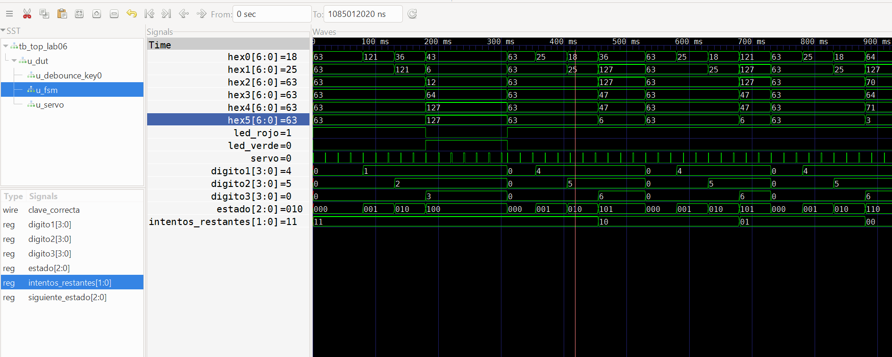

# Lab06 - Máquinas de Estado Finito: CAJA FUERTE en FPGA.

## Integrantes

    * [Cristian Santiago Alfonso Valderrama]
    (https://github.com/CristianAlfonso-ecci) 
    * [Fredi Alexander Melo Prada]
    (https://github.com/Fredi-melo-ecci) 
    * [Fabiam Acevedo]
    (https://github.com/Fabiam-Acevedo-ECCI) 

## 3. Implementación en FPGA

En esta sección se incorporan las evidencias obtenidas durante la implementación y demostración del funcionamiento de los circuitos en FPGA.

[Ver implementación de MAQUINA DE ESTADO (FSM) CAJA FUERTE descrito en FPGA con salida en display de 7 segmentos](https://youtu.be/O2HmUpszEV8)

### IMAGEN SIMULACION
- Caja_fuerte.v



## 4. ARchivos verilog 

### Módulo antirebote.v

```verilog

module debounce #(
    parameter integer CLK_HZ     = 50_000_000,
    parameter integer MS_ESTABLE = 20
)(
    input  wire clk,
    input  wire rst,
    input  wire boton,

    output reg  pulso
);

    // -------------------------------------------------
    // Tiempo de estabilidad requerido.
    // A 50 MHz y 20 ms:
    // CICLOS_ESTABLES = 1_000_000.
    // -------------------------------------------------
    localparam integer CICLOS_CALCULADOS =
        (CLK_HZ / 1000) * MS_ESTABLE;

    localparam integer CICLOS_ESTABLES =
        (CICLOS_CALCULADOS < 1) ? 1 : CICLOS_CALCULADOS;

    localparam integer BITS_CONTADOR =
        (CICLOS_ESTABLES <= 1) ? 1 :
        $clog2(CICLOS_ESTABLES);

    // -------------------------------------------------
    // Sincronizacion del boton.
    // Boton activo en bajo:
    // 1 = liberado.
    // 0 = presionado.
    // -------------------------------------------------
    reg boton_meta;
    reg boton_sync;

    reg boton_estable;
    reg [BITS_CONTADOR-1:0] contador;

    // -------------------------------------------------
    // Sincronizador de dos etapas.
    // -------------------------------------------------
    always @(posedge clk) begin
        if (rst) begin
            boton_meta <= 1'b1;
            boton_sync <= 1'b1;
        end
        else begin
            boton_meta <= boton;
            boton_sync <= boton_meta;
        end
    end

    // -------------------------------------------------
    // Antirrebote y pulso de pulsacion.
    // -------------------------------------------------
    always @(posedge clk) begin
        if (rst) begin
            boton_estable <= 1'b1;
            contador      <= {BITS_CONTADOR{1'b0}};
            pulso         <= 1'b0;
        end
        else begin

            // El pulso dura solamente un ciclo.
            pulso <= 1'b0;

            if (boton_sync == boton_estable) begin

                // Sin cambio pendiente:
                // reiniciar el contador.
                contador <= {BITS_CONTADOR{1'b0}};

            end
            else begin

                // La lectura difiere del estado aceptado.
                // Exigir estabilidad antes de aceptarla.
                if (contador == CICLOS_ESTABLES - 1) begin

                    contador      <= {BITS_CONTADOR{1'b0}};
                    boton_estable <= boton_sync;

                    // Solo generar pulso al presionar.
                    // Al liberar no se genera pulso.
                    if (boton_sync == 1'b0)
                        pulso <= 1'b1;

                end
                else begin
                    contador <= contador + 1'b1;
                end

            end
        end
    end

endmodule

```

### Módulo display_7seg


```verilog
module display_7seg (
    input  wire [3:0] digito,
    output reg  [6:0] seg
);

    // Orden de bits: g f e d c b a.
    // Activo en bajo: 0 enciende y 1 apaga.

    always @(*) begin
        case (digito)
            4'h0: seg = 7'b1000000;
            4'h1: seg = 7'b1111001;
            4'h2: seg = 7'b0100100;
            4'h3: seg = 7'b0110000;
            4'h4: seg = 7'b0011001;
            4'h5: seg = 7'b0010010;
            4'h6: seg = 7'b0000010;
            4'h7: seg = 7'b1111000;
            4'h8: seg = 7'b0000000;
            4'h9: seg = 7'b0010000;
            4'hA: seg = 7'b0001000;
            4'hB: seg = 7'b0000011;
            4'hC: seg = 7'b1000110;
            4'hD: seg = 7'b0100001;
            4'hE: seg = 7'b0000110;
            4'hF: seg = 7'b0001110;
            default: seg = 7'b1111111;
        endcase
    end

endmodule

```

### Módulo divisor_1hz

```verilog
module divisor_1hz #(
    parameter integer CLK_HZ = 50_000_000
)(
    input  wire clk,
    input  wire rst,
    output reg  clk_1hz
);

    // Semiperiodo de 0,5 s.
    localparam integer LIMITE = (CLK_HZ / 2) - 1;

    reg [24:0] contador;

    always @(posedge clk) begin
        if (rst) begin
            contador <= 25'd0;
            clk_1hz  <= 1'b0;
        end
        else begin
            if (contador == LIMITE) begin
                contador <= 25'd0;
                clk_1hz  <= ~clk_1hz;
            end
            else begin
                contador <= contador + 25'd1;
            end
        end
    end

endmodule
```

### Módulo servo_pwm

```verilog

module servo_pwm #(
    parameter integer CLK_HZ = 50_000_000,

    // Valores iniciales segun la guia del laboratorio.
    // Ajustar segun la calibracion del servo.
    parameter integer PULSO_CERRADO_US = 1000,
    parameter integer PULSO_ABIERTO_US = 2000
)(
    input  wire clk,
    input  wire rst,
    input  wire posicion,

    output wire servo_pwm
);

    // -------------------------------------------------
    // Periodo PWM: 20 ms, equivalente a 50 Hz.
    // A 50 MHz: 1_000_000 ciclos.
    // -------------------------------------------------
    localparam integer CICLOS_PERIODO =
        CLK_HZ / 50;

    // -------------------------------------------------
    // Conversion de microsegundos a ciclos.
    // A 50 MHz: 50 ciclos por microsegundo.
    // -------------------------------------------------
    localparam integer CICLOS_POR_US =
        CLK_HZ / 1_000_000;

    localparam integer CICLOS_CERRADO =
        CICLOS_POR_US * PULSO_CERRADO_US;

    localparam integer CICLOS_ABIERTO =
        CICLOS_POR_US * PULSO_ABIERTO_US;

    localparam integer BITS_CONTADOR =
        (CICLOS_PERIODO <= 1) ? 1 :
        $clog2(CICLOS_PERIODO);

    reg [BITS_CONTADOR-1:0] contador;
    reg posicion_periodo;

    wire [BITS_CONTADOR-1:0] ancho_pulso;

    // -------------------------------------------------
    // Usar la posicion almacenada para todo el periodo.
    // -------------------------------------------------
    assign ancho_pulso =
        posicion_periodo ? CICLOS_ABIERTO : CICLOS_CERRADO;

    // -------------------------------------------------
    // Contador del periodo y captura de posicion.
    // -------------------------------------------------
    always @(posedge clk) begin
        if (rst) begin
            contador         <= {BITS_CONTADOR{1'b0}};
            posicion_periodo <= 1'b0;
        end
        else begin
            if (contador == CICLOS_PERIODO - 1) begin
                contador         <= {BITS_CONTADOR{1'b0}};
                posicion_periodo <= posicion;
            end
            else begin
                contador <= contador + 1'b1;
            end
        end
    end

    // -------------------------------------------------
    // Salida PWM activa en alto.
    // Durante rst, la salida permanece en cero.
    // -------------------------------------------------
    assign servo_pwm =
        (!rst) && (contador < ancho_pulso);

endmodule

```

### Módulo caja_fuerte_fsm

```verilog
module caja_fuerte_fsm (
    input  wire       clk,
    input  wire       rst,
    input  wire       key0_pulso,
    input  wire [3:0] switches,

    output reg        servo_posicion,
    output reg        led_verde,
    output reg        led_rojo,

    output reg [6:0]  hex5,
    output reg [6:0]  hex4,
    output reg [6:0]  hex3,
    output reg [6:0]  hex2,
    output reg [6:0]  hex1,
    output reg [6:0]  hex0
);

    // -------------------------------------------------
    // Estados
    // -------------------------------------------------
    localparam [2:0]
        S_INICIO  = 3'd0,
        S_CAP1    = 3'd1,
        S_CAP2    = 3'd2,
        S_VERIF   = 3'd3,
        S_ABIERTO = 3'd4,
        S_ERROR   = 3'd5,
        S_BLOQUEO = 3'd6;

    // -------------------------------------------------
    // Clave secreta: 1 - 2 - 3
    // Cada digito admite valores de 0 a F.
    // -------------------------------------------------
    localparam [3:0]
        CLAVE_D1 = 4'h1,
        CLAVE_D2 = 4'h2,
        CLAVE_D3 = 4'h3;

    // -------------------------------------------------
    // Patrones de display
    // Orden: g f e d c b a
    // 0 = encendido; 1 = apagado.
    // -------------------------------------------------
    localparam [6:0]
        SEG_APAGADO = 7'b1111111,
        SEG_GUION   = 7'b0111111,

        SEG_O       = 7'b1000000,
        SEG_P       = 7'b0001100,
        SEG_E       = 7'b0000110,
        SEG_n       = 7'b0101011,

        SEG_r       = 7'b0101111,
        SEG_b       = 7'b0000011,
        SEG_L       = 7'b1000111,
        SEG_C       = 7'b1000110;

    reg [2:0] estado;
    reg [2:0] siguiente_estado;

    reg [3:0] digito1;
    reg [3:0] digito2;
    reg [3:0] digito3;

    reg [1:0] intentos_restantes;

    wire clave_correcta;

    assign clave_correcta =
        (digito1 == CLAVE_D1) &&
        (digito2 == CLAVE_D2) &&
        (digito3 == CLAVE_D3);

    // -------------------------------------------------
    // Decodificador hexadecimal activo en bajo
    // -------------------------------------------------
    function [6:0] decodificar_hex;
        input [3:0] valor;
        begin
            case (valor)
                4'h0: decodificar_hex = 7'b1000000;
                4'h1: decodificar_hex = 7'b1111001;
                4'h2: decodificar_hex = 7'b0100100;
                4'h3: decodificar_hex = 7'b0110000;
                4'h4: decodificar_hex = 7'b0011001;
                4'h5: decodificar_hex = 7'b0010010;
                4'h6: decodificar_hex = 7'b0000010;
                4'h7: decodificar_hex = 7'b1111000;
                4'h8: decodificar_hex = 7'b0000000;
                4'h9: decodificar_hex = 7'b0010000;
                4'hA: decodificar_hex = 7'b0001000;
                4'hB: decodificar_hex = 7'b0000011;
                4'hC: decodificar_hex = 7'b1000110;
                4'hD: decodificar_hex = 7'b0100001;
                4'hE: decodificar_hex = 7'b0000110;
                4'hF: decodificar_hex = 7'b0001110;
                default:
                    decodificar_hex = SEG_APAGADO;
            endcase
        end
    endfunction

    // =================================================
    // 1. Registro de estado, digitos e intentos
    // =================================================
    always @(posedge clk) begin
        if (rst) begin
            estado             <= S_INICIO;
            digito1            <= 4'd0;
            digito2            <= 4'd0;
            digito3            <= 4'd0;
            intentos_restantes <= 2'd3;
        end
        else begin
            estado <= siguiente_estado;

            case (estado)

                S_INICIO: begin
                    if (key0_pulso) begin
                        digito1 <= switches;
                    end
                end

                S_CAP1: begin
                    if (key0_pulso) begin
                        digito2 <= switches;
                    end
                end

                S_CAP2: begin
                    if (key0_pulso) begin
                        digito3 <= switches;
                    end
                end

                S_VERIF: begin
                    // Se descuenta una sola vez,
                    // despues de capturar toda la clave.
                    if (!clave_correcta &&
                        (intentos_restantes != 2'd0)) begin

                        intentos_restantes <=
                            intentos_restantes - 2'd1;
                    end
                end

                S_ERROR: begin
                    // KEY0 reconoce el error.
                    // No captura un nuevo digito
                    // ni restablece los intentos.
                    if (key0_pulso) begin
                        digito1 <= 4'd0;
                        digito2 <= 4'd0;
                        digito3 <= 4'd0;
                    end
                end

                default: begin
                    // Conserva los registros.
                end

            endcase
        end
    end

    // =================================================
    // 2. Logica de proximo estado
    // =================================================
    always @(*) begin
        siguiente_estado = estado;

        case (estado)

            S_INICIO: begin
                if (key0_pulso)
                    siguiente_estado = S_CAP1;
            end

            S_CAP1: begin
                if (key0_pulso)
                    siguiente_estado = S_CAP2;
            end

            S_CAP2: begin
                if (key0_pulso)
                    siguiente_estado = S_VERIF;
            end

            S_VERIF: begin
                if (clave_correcta) begin
                    siguiente_estado = S_ABIERTO;
                end
                else if (intentos_restantes <= 2'd1) begin
                    siguiente_estado = S_BLOQUEO;
                end
                else begin
                    siguiente_estado = S_ERROR;
                end
            end

            S_ABIERTO: begin
                // Solo rst permite volver a cerrar.
                siguiente_estado = S_ABIERTO;
            end

            S_ERROR: begin
                if (key0_pulso)
                    siguiente_estado = S_INICIO;
            end

            S_BLOQUEO: begin
                // KEY0 no desbloquea la caja.
                // Solo rst permite salir.
                siguiente_estado = S_BLOQUEO;
            end

            default: begin
                siguiente_estado = S_INICIO;
            end

        endcase
    end

    // =================================================
    // 3. Salidas y seleccion de displays
    // =================================================
    always @(*) begin

        // Condicion predeterminada: caja cerrada.
        servo_posicion = 1'b0;
        led_verde      = 1'b0;
        led_rojo       = 1'b1;

        // Mensaje predeterminado: ------
        hex5 = SEG_GUION;
        hex4 = SEG_GUION;
        hex3 = SEG_GUION;
        hex2 = SEG_GUION;
        hex1 = SEG_GUION;
        hex0 = SEG_GUION;

        case (estado)

            S_INICIO: begin
                // ------
            end

            S_CAP1: begin
                // -----d1
                hex0 = decodificar_hex(digito1);
            end

            S_CAP2: begin
                // ----d1d2
                hex1 = decodificar_hex(digito1);
                hex0 = decodificar_hex(digito2);
            end

            S_VERIF: begin
                // ---d1d2d3
                // Este estado dura un ciclo de reloj.
                hex2 = decodificar_hex(digito1);
                hex1 = decodificar_hex(digito2);
                hex0 = decodificar_hex(digito3);
            end

            S_ABIERTO: begin
                servo_posicion = 1'b1;
                led_verde      = 1'b1;
                led_rojo       = 1'b0;

                // "  OPEn"
                // La n aproxima la N en 7 segmentos.
                hex5 = SEG_APAGADO;
                hex4 = SEG_APAGADO;
                hex3 = SEG_O;
                hex2 = SEG_P;
                hex1 = SEG_E;
                hex0 = SEG_n;
            end

            S_ERROR: begin
                // "Err  2" o "Err  1"
                // El descuento ya fue realizado.
                hex5 = SEG_E;
                hex4 = SEG_r;
                hex3 = SEG_r;
                hex2 = SEG_APAGADO;
                hex1 = SEG_APAGADO;
                hex0 = decodificar_hex(
                    {2'b00, intentos_restantes}
                );
            end

            S_BLOQUEO: begin
                // "bLOC 0": bloqueo, cero intentos.
                hex5 = SEG_b;
                hex4 = SEG_L;
                hex3 = SEG_O;
                hex2 = SEG_C;
                hex1 = SEG_APAGADO;
                hex0 = decodificar_hex(
                    {2'b00, intentos_restantes}
                );
            end

            default: begin
                // Mantiene la orden de cerrado.
            end

        endcase
    end

endmodule
```

### Módulo top


```verilog
`include "antirebote.v"
`include "servo.v"  
`include "caja_fuerte_fsm.v"  

module top_lab06 (
    input  wire       clk,
    input  wire       key0,
    input  wire       key1,
    input  wire [3:0] sw,

    output wire       servo,
    output wire       led_verde,
    output wire       led_rojo,

    output wire [6:0] hex5,
    output wire [6:0] hex4,
    output wire [6:0] hex3,
    output wire [6:0] hex2,
    output wire [6:0] hex1,
    output wire [6:0] hex0
);

    // -------------------------------------------------
    // Senales internas
    // -------------------------------------------------
    wire rst;
    wire key0_pulso;
    wire servo_posicion;

    // -------------------------------------------------
    // Reinicio con KEY1.
    // Boton activo en bajo:
    // KEY1 = 0 -> rst = 1.
    // -------------------------------------------------
    assign rst = ~key1;

    // -------------------------------------------------
    // Antirrebote de KEY0.
    // Genera un pulso por cada pulsacion.
    // -------------------------------------------------
    debounce #(
        .CLK_HZ(50_000_000),
        .MS_ESTABLE(20)
    ) u_debounce_key0 (
        .clk(clk),
        .rst(rst),
        .boton(key0),
        .pulso(key0_pulso)
    );

    // -------------------------------------------------
    // Maquina de estados de la caja fuerte.
    // -------------------------------------------------
    caja_fuerte_fsm u_fsm (
        .clk(clk),
        .rst(rst),
        .key0_pulso(key0_pulso),
        .switches(sw),

        .servo_posicion(servo_posicion),
        .led_verde(led_verde),
        .led_rojo(led_rojo),

        .hex5(hex5),
        .hex4(hex4),
        .hex3(hex3),
        .hex2(hex2),
        .hex1(hex1),
        .hex0(hex0)
    );

    // -------------------------------------------------
    // Generador PWM del servo.
    // posicion = 0 -> orden de cerrado.
    // posicion = 1 -> orden de abierto.
    // -------------------------------------------------
    servo_pwm #(
        .CLK_HZ(50_000_000)
    ) u_servo (
        .clk(clk),
        .rst(rst),
        .posicion(servo_posicion),
        .servo_pwm(servo)
    );

endmodule

```

### Módulo top


```verilog