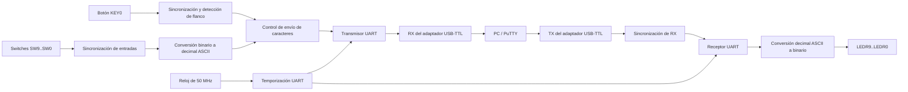
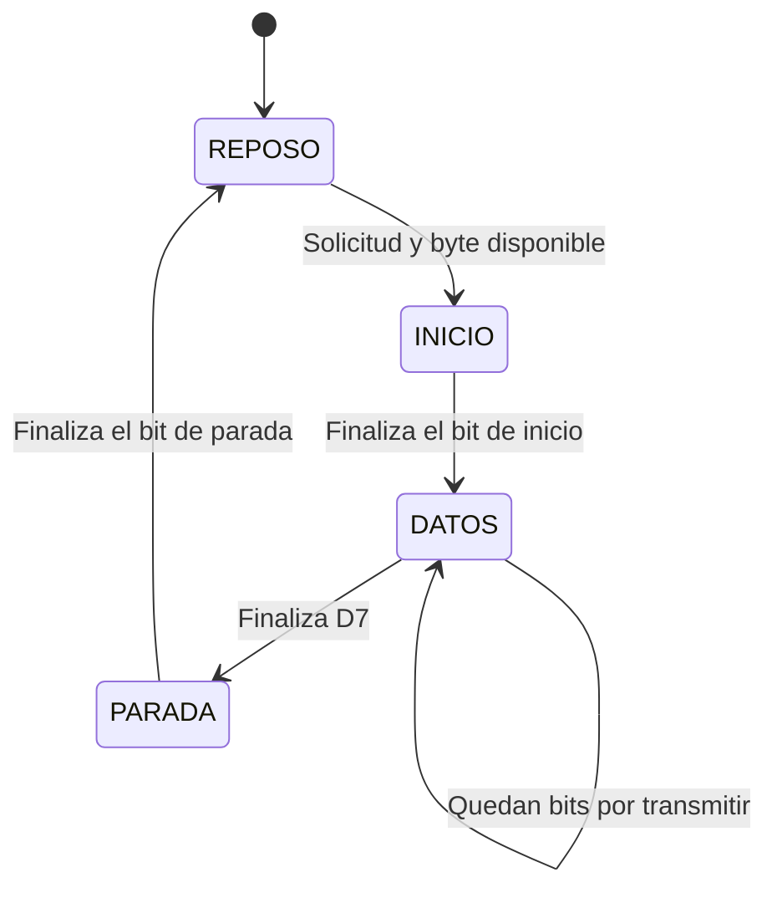
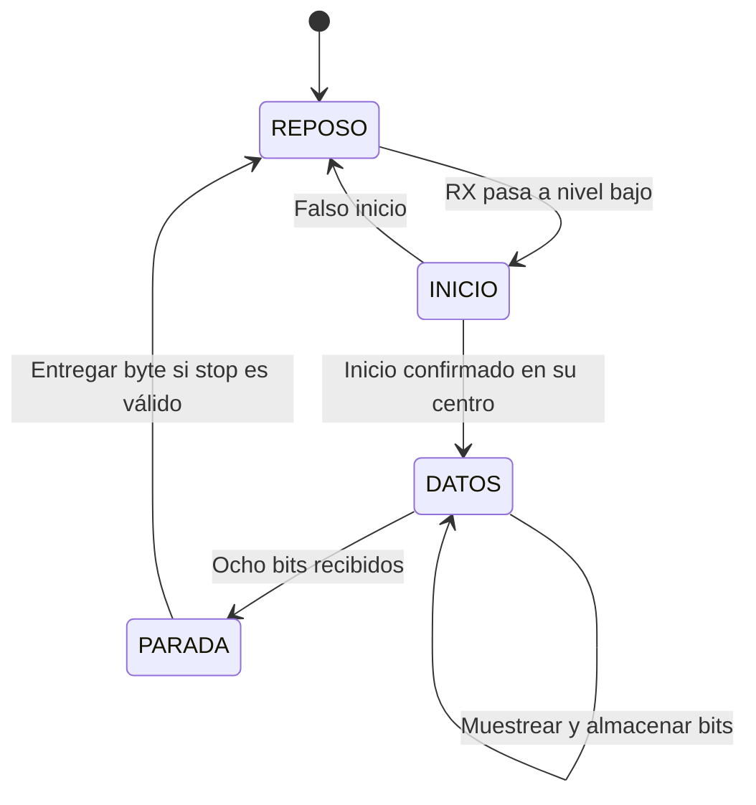
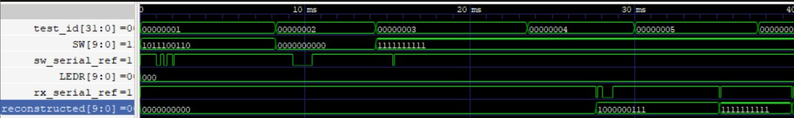
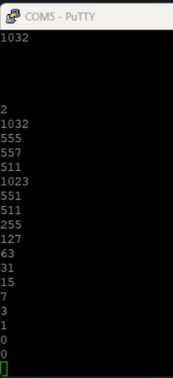
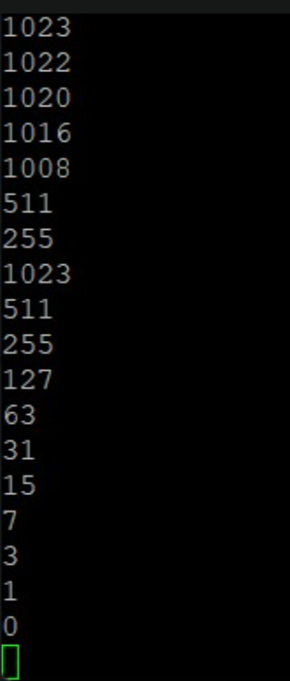

# Lab07 Proyecto final - Enlace de Comunicación Serial UART entre FPGA y PC.

## 1. Integrantes

    * [Cristian Santiago Alfonso Valderrama]
    (https://github.com/CristianAlfonso-ecci) 
    * [Fredi Alexander Melo Prada]
    (https://github.com/Fredi-melo-ecci) 
    * [Fabiam Acevedo]
    (https://github.com/Fabiam-Acevedo-ECCI) 

## 2. Resumen

El proyecto consiste en implementar un enlace de comunicación serial UART bidireccional entre una FPGA DE10-Lite y un computador. El sistema integra transmisión, recepción, temporización, conversión de datos y manejo de entradas y salidas.

En el sentido FPGA → PC, el usuario selecciona un número entre 0 y 1023 mediante los diez switches de la tarjeta y solicita su transmisión con el botón KEY0. El valor se convierte de binario a caracteres decimales ASCII para que pueda visualizarse en la terminal serial.

En el sentido PC → FPGA, el usuario escribe un número decimal en la terminal y lo confirma con Enter. Los caracteres recibidos se convierten en un valor binario de diez bits, cuya representación se presenta en los LEDs de la tarjeta.

La verificación del proyecto comprende la simulación del enlace en ambos sentidos y una demostración de su funcionamiento en la FPGA.

## 3. Objetivos

### 3.1 Objetivo general

Implementar en Verilog un sistema de comunicación UART bidireccional entre la FPGA DE10-Lite y un computador, con conversión entre valores binarios de diez bits y su representación decimal ASCII.

### 3.2 Objetivos específicos

- Implementar los bloques de transmisión y recepción UART.
- Generar la temporización necesaria a partir del reloj de 50 MHz.
- Convertir los valores de los switches en dígitos decimales ASCII.
- Reconstruir un número binario a partir de los caracteres recibidos.
- Controlar la solicitud de transmisión mediante el botón KEY0.
- Verificar las tramas y los datos reconstruidos mediante simulación.
- Demostrar la comunicación en ambos sentidos mediante la tarjeta y PuTTY.

## 4. Especificaciones del sistema

| Característica | Especificación |
|---|---|
| Rango de valores | 0 a 1023 |
| Entrada numérica de transmisión | SW9..SW0 |
| Solicitud de transmisión | Pulsación de KEY0 |
| Salida numérica de recepción | LEDR9..LEDR0 |
| Representación de los números en el enlace | Texto decimal ASCII |
| Velocidad configurada | 9600 baudios |
| Formato UART | 8-N-1 |
| Orden de transmisión de cada byte | Bit menos significativo primero |
| Estado de reposo de la línea | Nivel lógico alto |
| Interfaz con el computador | Adaptador USB-TTL de 3.3 V |

La comunicación es asíncrona: no se transmite una señal de reloj entre el computador y la FPGA. Ambos extremos deben utilizar la misma velocidad y el mismo formato de trama.

## 5. Arquitectura del sistema

### 5.1 Diagrama de bloques



El diagrama representa la organización funcional del sistema. La temporización puede implementarse mediante un generador compartido o mediante contadores internos, según la organización de los módulos.

### 5.2 Función de los bloques

| Bloque funcional | Responsabilidad |
|---|---|
| Módulo superior | Interconectar entradas, salidas y bloques de comunicación. |
| Control de transmisión | Capturar el valor seleccionado y coordinar el envío de sus caracteres. |
| Conversión binario → ASCII | Obtener los dígitos decimales del valor de diez bits. |
| Transmisor UART | Serializar cada carácter con bits de inicio y parada. |
| Temporización | Establecer la duración de los bits y los instantes de muestreo. |
| Receptor UART | Reconstruir cada byte recibido por la entrada serial. |
| Conversión ASCII → binario | Acumular los dígitos recibidos y reconocer el fin del número. |
| Sincronización | Incorporar las entradas asíncronas al dominio del reloj de la FPGA. |

Los nombres de estos bloques describen sus funciones; no requieren que cada función corresponda a un archivo independiente.

## 6. Formato de comunicación UART

Se utiliza el formato 8-N-1:

- Un bit de inicio en nivel bajo.
- Ocho bits de datos.
- Sin bit de paridad.
- Un bit de parada en nivel alto.

```text
Reposo | Inicio | D0 D1 D2 D3 D4 D5 D6 D7 | Parada | Reposo
   1   |   0    |      LSB primero       |   1    |   1
```

Cada carácter ocupa diez tiempos de bit: uno de inicio, ocho de datos y uno de parada.

A 9600 baudios:

T_bit = 1 / 9600 ≈ 104.167 µs

Por tanto, la duración aproximada de una trama es:

T_trama = 10 × T_bit ≈ 1.04167 ms

Un número puede necesitar hasta cuatro caracteres decimales. Por ejemplo, `1023` requiere cuatro tramas UART, sin contar posibles caracteres adicionales de fin de línea.

## 7. Generación de baudios

El reloj principal tiene una frecuencia de 50 MHz. Para generar una duración de bit correspondiente a 9600 baudios:

N = f_clk / baud

N = 50 000 000 / 9600

N ≈ 5208.333 ciclos por bit

Con una división entera de 5208 ciclos:

T_bit_real = 5208 / 50 000 000
           = 104.16 µs

baud_real = 50 000 000 / 5208
          ≈ 9600.614 baudios

El error relativo es aproximadamente:

Error = ((9600.614 − 9600) / 9600) × 100
      ≈ 0.0064 %

Para obtener 5208 ciclos, un contador que comienza en cero debe recorrer desde 0 hasta 5207.

Este cálculo corresponde a una temporización de un bit completo. Si el receptor utiliza sobremuestreo, su contador debe calcularse para la frecuencia de muestreo elegida.

## 8. Máquinas de estados

Los siguientes diagramas describen la secuencia funcional de transmisión y recepción. Los estados de carga, espera o entrega del dato pueden estar separados o integrados en otros estados dentro del código.

### 8.1 FSM del transmisor



| Estado funcional | Operación |
|---|---|
| Reposo | Mantener TX en alto y esperar una solicitud. |
| Inicio | Mantener TX en bajo durante un tiempo de bit. |
| Datos | Transmitir los ocho bits, empezando por D0. |
| Parada | Mantener TX en alto durante un tiempo de bit. |

El control de envío debe esperar a que termine una trama antes de solicitar la transmisión del siguiente carácter del número.

### 8.2 FSM del receptor



| Estado funcional | Operación |
|---|---|
| Reposo | Esperar el comienzo de una trama. |
| Inicio | Confirmar el bit de inicio cerca de su centro. |
| Datos | Muestrear y reconstruir los ocho bits recibidos. |
| Parada | Comprobar el cierre de la trama y finalizar la recepción. |

Después de confirmar el centro del bit de inicio, el receptor puede muestrear los bits de datos a intervalos de un tiempo de bit. Un diseño con sobremuestreo utiliza varias muestras por bit; esperar al centro con un contador no implica, por sí solo, realizar sobremuestreo.

## 9. Conversión de datos

### 9.1 Transmisión: binario a decimal ASCII

Los diez switches representan un valor binario sin signo entre 0 y 1023. Para mostrarlo como número decimal en PuTTY, se convierte en una secuencia de caracteres ASCII.

Una descomposición decimal posible es:

```text
millares = valor / 1000
centenas = (valor % 1000) / 100
decenas  = (valor % 100) / 10
unidades = valor % 10
```

Cada dígito se convierte en carácter sumando el código ASCII de `0`:

```text
caracter_ascii = digito + 8'h30
```

Por ejemplo:

```text
Valor binario:   10'b1111111111
Valor decimal:   1023
Texto enviado:  "1023"
Bytes ASCII:     31 30 32 33  (hexadecimal)
```

La forma de generar estos dígitos puede variar: divisiones y residuos, conversión a BCD u otra implementación equivalente.

El cero debe producir al menos el carácter `0`. La supresión de ceros a la izquierda o el uso de un ancho fijo depende del formato implementado.

### 9.2 Recepción: decimal ASCII a binario

El receptor UART entrega los caracteres uno por uno. Para cada carácter entre `0` y `9`, se obtiene el dígito y se actualiza el acumulador:

```text
digito = caracter_ascii - 8'h30
nuevo_valor = valor_anterior × 10 + digito
```

Ejemplo para `1023`:

| Carácter | Operación | Valor acumulado |
|---|---|---:|
| `1` | 0 × 10 + 1 | 1 |
| `0` | 1 × 10 + 0 | 10 |
| `2` | 10 × 10 + 2 | 102 |
| `3` | 102 × 10 + 3 | 1023 |

Al recibir el terminador asociado a Enter, se confirma el número para su representación en los LEDs y se prepara la recepción del siguiente.

La configuración de la terminal y el conversor deben ser coherentes respecto al terminador: retorno de carro (`CR`, `0x0D`), salto de línea (`LF`, `0x0A`) o la secuencia `CR+LF`.

El rango especificado es de 0 a 1023. El tratamiento de caracteres no numéricos y valores fuera de rango debe corresponder a la política implementada en el código, sin confundir un desbordamiento con una conversión válida.

## 10. Entradas asíncronas y control del botón

La línea RX, los switches y el botón no están sincronizados con el reloj de 50 MHz. La guía requiere incorporarlos mediante etapas de sincronización de dos flip-flops.

En RX, esta medida reduce la probabilidad de propagar una condición de metastabilidad hacia la lógica de recepción.

En KEY0, la detección de flanco permite generar una solicitud de transmisión por evento de pulsación, en lugar de mantener la solicitud activa mientras el botón permanece presionado.

La sincronización, la detección de flanco y el antirrebote cumplen funciones diferentes. Detectar un flanco no elimina automáticamente los rebotes mecánicos.

Para capturar correctamente el valor seleccionado, los switches deben mantenerse estables alrededor de la pulsación. Sincronizar cada bit no garantiza por sí solo una captura coherente si varios switches cambian simultáneamente.

## 11. Simulación

La verificación debe cubrir los dos sentidos del enlace:

1. Transmisión desde los switches hacia la salida UART.
2. Recepción de caracteres UART y reconstrucción del valor mostrado en los LEDs.

### 11.1 Evidencia de transmisión FPGA → PC



### 11.2 Evidencia de recepción PC → FPGA






### 11.3 Valores de referencia

La siguiente tabla permite contrastar los valores numéricos con los patrones de switches o LEDs. Es una referencia de verificación, no un registro de pruebas ejecutadas.

| Valor decimal | Representación de diez bits | Caracteres decimales |
|---:|---|---|
| 0 | `0000000000` | `0` |
| 9 | `0000001001` | `9` |
| 10 | `0000001010` | `10` |
| 255 | `0011111111` | `255` |
| 256 | `0100000000` | `256` |
| 1023 | `1111111111` | `1023` |

Los casos 255 y 256 permiten comprobar la diferencia entre el rango de un byte y el rango completo del sistema. El caso 1023 verifica el límite superior.

## 12. Implementación física

### 12.1 Conexión del adaptador USB-TTL

| Señal de la FPGA | Conexión en el adaptador |
|---|---|
| GPIO_TX | RX |
| GPIO_RX | TX |
| GND | GND |

Las líneas se conectan de forma cruzada y los equipos deben compartir referencia de tierra.

La interfaz debe utilizar niveles lógicos de 3.3 V. No se deben aplicar niveles de 5 V ni conectar directamente una interfaz eléctrica RS-232 a los GPIO de la FPGA.

### 12.2 Configuración de PuTTY

| Parámetro | Configuración |
|---|---|
| Tipo de conexión | Serial |
| Puerto | [COM utilizado] |
| Velocidad | 9600 baudios |
| Bits de datos | 8 |
| Paridad | Ninguna |
| Bits de parada | 1 |
| Control de flujo | Ninguno |

### 12.3 Asignación de recursos

| Recurso | Función |
|---|---|
| SW9..SW0 | Seleccionar el número que se transmite. |
| KEY0 | Solicitar el envío del número. |
| LEDR9..LEDR0 | Representar el número recibido. |
| GPIO_TX | Salida serial hacia el computador. |
| GPIO_RX | Entrada serial desde el computador. |

Las asignaciones físicas de los pines deben conservarse en el archivo de restricciones del proyecto Quartus.

### 12.4 Demostración

[Ver video de demostración en FPGA](https://youtu.be/5rPxvhwCShs?si=jeLNKndxEmU9rLR4)


| Sentido | Valor demostrado | Ubicación en el video |
|---|---:|---|
| FPGA → PC | [Valor] | [Minuto y segundo] |
| PC → FPGA | [Valor] | [Minuto y segundo] |

## 13. Preguntas de análisis

### 13.1 ¿Por qué un solo byte UART no alcanza para representar los números 0–1023 y cómo lo resuelve el diseño?

Un byte tiene ocho bits y permite representar 256 combinaciones, de 0 a 255 si se interpreta como un entero sin signo. El intervalo de 0 a 1023 contiene 1024 valores y necesita diez bits:

2^10 = 1024

El sistema resuelve esta diferencia enviando el número como texto decimal ASCII. Cada dígito ocupa un byte y se transmite en su propia trama UART.

Por ejemplo, `1023` se envía mediante cuatro caracteres: `1`, `0`, `2` y `3`. En recepción se reconstruye el valor numérico a partir de esos caracteres.

### 13.2 Calcule el número de cuentas del generador de baudios para 9600 baudios con un reloj de 50 MHz.

El número ideal de ciclos por bit es:

N = 50 000 000 / 9600
  ≈ 5208.333

Una implementación entera puede utilizar 5208 ciclos por bit. Si el contador comienza en cero, el valor terminal es 5207.

La velocidad resultante es aproximadamente 9600.614 baudios, con un error de 0.0064 % respecto a 9600 baudios.

### 13.3 ¿Por qué el receptor es más complejo que el transmisor?

El transmisor controla el inicio y la duración de cada bit porque genera la trama con su propio reloj.

El receptor, en cambio, recibe una señal asíncrona y debe:

- Detectar el comienzo de la trama.
- Distinguir un inicio válido de una perturbación.
- Ubicar el centro de los bits.
- Reconstruir el byte en el orden correcto.
- Comprobar el bit de parada.
- Tolerar pequeñas diferencias entre los relojes de ambos extremos.

Por ello necesita más mecanismos de detección y validación temporal.

### 13.4 ¿Por qué se detecta el flanco del botón y no su nivel para transmitir?

Una pulsación dura muchos ciclos del reloj de 50 MHz. Si se utilizara directamente el nivel activo del botón, podrían generarse solicitudes repetidas durante una sola pulsación.

La detección de flanco convierte el cambio de estado del botón en un evento breve que puede utilizarse como una única solicitud de envío.

Además, si se requiere protección frente al rebote mecánico, debe incorporarse un filtro adecuado: la detección de flanco por sí sola no elimina los rebotes.

### 13.5 ¿Qué es un error de trama y cómo lo detectaría el receptor?

Un error de trama ocurre cuando no se cumple el formato esperado de la trama UART. En 8-N-1, una comprobación fundamental consiste en verificar que el bit de parada esté en nivel alto.

Después de recibir los ocho bits de datos, el receptor muestrea la posición correspondiente al bit de parada. Si encuentra un nivel bajo, puede activar una señal de error y descartar el byte.

Una configuración incorrecta de velocidad o formato, el ruido y la pérdida de alineación pueden producir este error.

Esta comprobación no equivale a verificar el contenido completo del mensaje: sin paridad u otro mecanismo adicional, algunos errores en los bits de datos pueden pasar inadvertidos.

### 13.6 ¿Por qué es necesario sincronizar la línea RX antes de usarla en la FSM?

La línea RX puede cambiar cerca de un flanco del reloj interno. Esto puede incumplir los tiempos de establecimiento o mantenimiento del primer flip-flop y provocar metastabilidad.

Una cadena de dos flip-flops proporciona tiempo adicional para que la señal se estabilice antes de utilizarla en la FSM, reduciendo la probabilidad de que una condición metastable se propague.

La sincronización no corrige errores de velocidad ni sustituye el muestreo de los bits; permite incorporar la señal externa al dominio del reloj interno con menor riesgo.

### 13.7 ¿Qué diferencia habría entre enviar el número en binario crudo y enviarlo como texto ASCII?

En binario crudo se transmiten directamente los bits del valor. Como el rango requiere diez bits, una solución sencilla utiliza dos bytes y define cómo se distribuyen los bits y en qué orden se envían.

En ASCII se transmiten los caracteres de la representación decimal. Por ejemplo:

| Representación de 1023 | Bytes enviados en hexadecimal |
|---|---|
| Binario crudo, byte alto primero | `03 FF` |
| Texto ASCII `1023` | `31 30 32 33` |

El binario crudo resulta más compacto para los valores de varios dígitos, pero no aparece necesariamente como texto legible en una terminal y requiere acordar el formato del mensaje.

ASCII facilita la interacción con PuTTY y permite escribir los números directamente. A cambio, requiere conversiones y una forma de identificar el final del número.

## 14. Conclusiones

1. El enlace UART integra lógica secuencial para el control de tramas y lógica de conversión para relacionar los datos de usuario con los bytes transmitidos.

2. El formato decimal ASCII permite transportar valores de diez bits mediante tramas de ocho bits de datos, manteniendo una representación legible en la terminal.

3. El receptor requiere especial atención a la sincronización y al instante de muestreo, mientras que el transmisor controla directamente la temporización de su salida.

4. La generación de baudios debe considerar tanto el cálculo del divisor como el intervalo real del contador, evitando errores de una cuenta.

5. La verificación del proyecto debe relacionar tres niveles: el valor numérico, los caracteres ASCII y las tramas UART. Comprobar solamente actividad en TX o RX no demuestra que el número se haya transferido correctamente.

6. Las evidencias de simulación y la demostración física documentan aspectos complementarios: las primeras permiten inspeccionar la temporización interna y la segunda comprueba la integración con la tarjeta, el adaptador y la terminal.

## 15. Entregables y organización del repositorio

La entrega incluye:

- Código fuente Verilog del sistema, en la carpeta (Archivos_Verilog).
- Documentación del diseño en este README.
- Evidencias de transmisión FPGA → PC.
- Evidencias de recepción PC → FPGA.
- Video de la demostración física en ambos sentidos.

## 16. Referencia

- Guía del Laboratorio 7 — Proyecto final: enlace de comunicación serial UART entre FPGA y PC. Técnicas Digitales, ECCI.

  https://github.com/digital-ECCI/tecnicas-digitales-ECCI-2026-II/tree/main/labs/07_lab07

- Manual de usuario DE10-Lite Cost-effective Max 10 board
